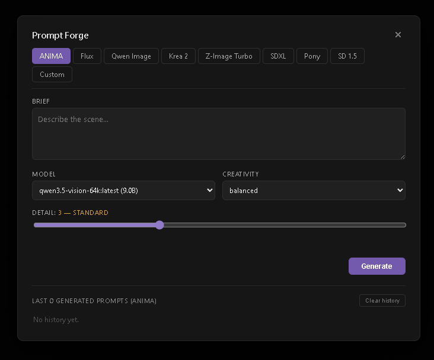

# Prompt Forge for ComfyUI

A standalone ComfyUI node that writes image prompts with a local
[Ollama](https://ollama.com) model. One node, **9 model profiles**, per-profile
history and settings, and zero dependencies beyond what ComfyUI already ships.

Switch between **ANIMA**, **Flux**, **Qwen Image**, **Krea 2**, **Z-Image Turbo**,
**SDXL**, **Pony**, **SD 1.5**, or your own **Custom** profile — each with its
own system prompt, slot guide, forbidden words, and detail levels.



---

## Features

- **9 built-in profiles** — one tab per model family, each with tuned prompting rules.
- **Per-profile memory** — model, creativity, detail, and brief are remembered separately for every tab.
- **Per-profile history** — the last 10 generations per tab, with Restore / Use brief buttons.
- **Detail slider with named levels** — from *Minimal* to *Maximum*, calibrated per model.
- **Custom tab** — write your own system prompt directly in the overlay.
- **VRAM-friendly** — the Ollama model is unloaded immediately after each request (`keep_alive: 0`), plus a backstop unload before every graph run.
- **Standalone** — no dependencies on other custom node packs, no `requests`, no `pyyaml`, no API keys.
- **Workflow-safe** — settings and history travel with the workflow, size is preserved on reload.

---

## Supported profiles

| Tab | Style | Detail levels | Notes |
|---|---|---|---|
| **ANIMA** | natural language | 1–7 | 7-slot structured description, ≤25 elements |
| **Flux** | natural language, cinematic | 1–5 | No quality tags, no booru |
| **Qwen Image** | natural language | 1–5 | Supports quoted text inside the prompt |
| **Krea 2** | artistic, evocative | 1–5 | Style words welcome |
| **Z-Image Turbo** | short natural language | 1–3 | Keep it under 35 words |
| **SDXL** | mixed tags + sentence | 1–5 | Quality tags help |
| **Pony** | booru tags with `score_*` | 1–5 | Auto-prepends `score_9, score_8_up, score_7_up, source_*` |
| **SD 1.5** | booru tags | 1–5 | Classic Danbooru syntax |
| **Custom** | your system prompt | 1–5 | Editable in the overlay |

---

## Installation

### 1. Install Ollama

Download from [ollama.com](https://ollama.com) and pull at least one model:

```bash
ollama pull qwen3.5-vision:latest